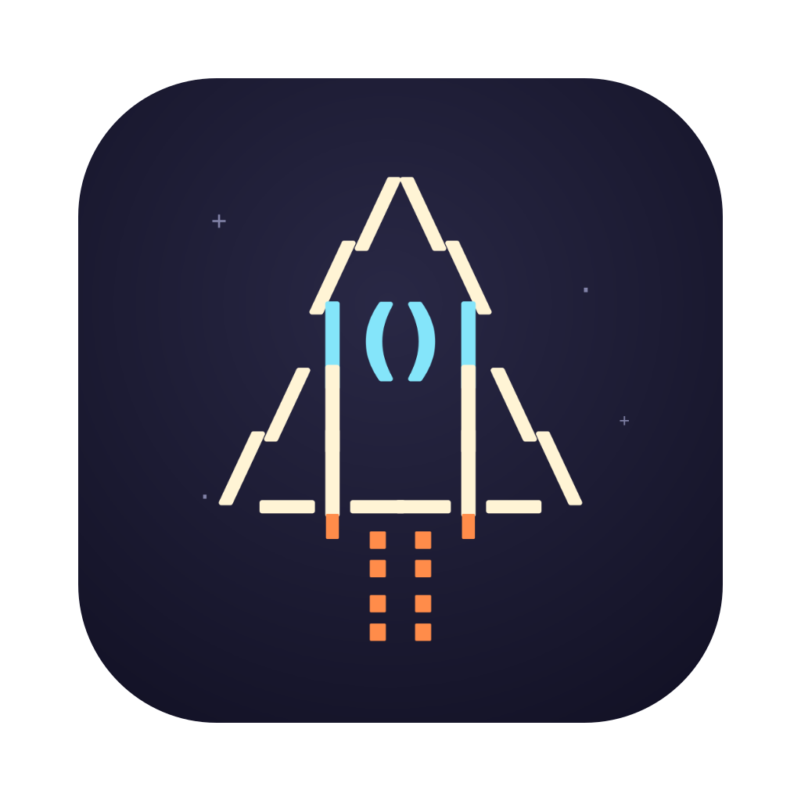

# Spaceport



Spaceport is an independent desktop fork of
[Sheprd](https://github.com/sheprd-labs/sheprd). It is under development. A signed,
notarized [macOS arm64 preview](https://github.com/2389-research/spaceport/releases/tag/v20261126.3)
is available for macOS 14.2 or later. The [Spaceport specification](docs/spaceport/START_HERE.md)
defines the product and ownership rules. The [task plan](docs/spaceport/plan/tasks.json),
[capability matrix](docs/spaceport/plan/capabilities.json), and
[acceptance record](docs/spaceport/plan/acceptance.json) show what has been
checked and what remains open. The [feature reachability snapshot](docs/spaceport/evidence/removal-reachability-e99d575b.md)
maps retained and excluded source routes at the revision it names.

The target app keeps native terminals, rich chats, workspaces, customization,
file interactions, service access, notifications, diagnostics, and a local
desktop CLI. It removes the old IDE, Git, GitHub, embedded browser, cloud
provisioning, Teleport, orchestration, mod, scheduler, and phone control
features. One leftover of those features remains in the tree: the tab renderer
in `crates/spaceport-browser`. A tab shows a device list or a Core terminal and never a web page, so
nothing in the UI opens a browser tab; a URL opens in the system browser. A
build is not proof that the fork meets the specification.

Spaceport permits **separately installed Herdr 1 and Herdr Core** runtimes.
Herdr Core is experimental and disabled by default, including existing installs.
Enable it in **Settings → General → Experimental → Enable Herdr Core**, then restart Spaceport.
Turning it off also takes effect after restart. Existing Core terminals keep running.
While disabled, Spaceport hides Core controls and does not connect to or start Core.
Existing Herdr 1 startup may remain to preserve the desktop UX. Each session
keeps its owning runtime; Spaceport does not install, update or migrate either
runtime. Tailscale is external. Core routes use Core's machine connections and
Spaceport presentation documents; Herdr 1 may use its native workspace model.
Native rich chat needs a verified host-side adapter
route; remote parity, forwarding, file transfer, native platform behavior, and
production release identity still have [open gates](docs/spaceport/plan/gaps.json).

## Desktop Agents sidebar

Click a host name or its arrow to fold or expand its rows. The status dot selects the host.
Click a status heading in Priority to fold or expand that group.
Priority lists agents waiting for you first, followed by working agents, done agents, and idle agents
grouped by approximate time (under an hour, one to five hours, and five hours or more).
Under an Idle heading, each row shows its elapsed idle time when known.
An agent already idle when Spaceport connects starts at the end in Herdr sequence order.
The app can show a lower bound once it has observed an hour of the same idle spell.
After 24 hours of observed idle time, an agent moves into **Quiet**, which starts folded.
Choose 24 hours, 48 hours, or 7 days under **Settings → Sidebar → Move idle agents to Quiet**.
Working agents and agents waiting for you return to their status group automatically.
Agent rows show the title on the first line.
The line underneath shows the app icon, terminal tab number, directory, and host.
Directories use a muted shade of the theme's blue. A soft background marks the focused agent across the row in the list and collapsed rail.
Split panes on the same tab share its number. Selecting a row opens that specific pane.
Custom Herdr rows keep their configured fields.
Click **priority** in the Agents header to return to workspace order.
A host's custom Herdr agent view keeps its chosen order.

## iPhone, iPad, and Android

[Spaceport Mobile](mobile/README.md) connects directly over SSH to an installed
Herdr TUI runtime. Its Swift and Kotlin apps link one Rust controller, built from
the separate Cargo workspace in `mobile/rust`. That workspace consumes the
desktop crates by path: `spaceport-client`, `spaceport-panes`,
`spaceport-backend`, and `spaceport-truncate`. So the rules both clients follow
live once — the navigation targets a focus request aims at, the cell map a
split's rectangles make, the upload staging scripts, and the truncation bounds.
A rule shared with the phone moves down into one of those crates instead of being
written twice.

## Work on the fork

Use the pinned Rust toolchain in `rust-toolchain.toml`. From the repository
root, the current development executable is named `spaceport`:

```sh
cargo +1.99.0 check --locked -p spaceport-gpui --bin spaceport
```

Every recurring check and task is a `just` recipe; run `just` with no arguments
to list them, and read [just-operations](docs/just-operations.md) for what each one
does. The app's crates have been leaving `crates/spaceport-gpui` one at a time, and
[gpui-split-plan](docs/gpui-split-plan.md) records what moved, what stayed on the
window, and where the next extraction goes.

Install the validator dependency as described in
[tools/README.md](docs/spaceport/tools/README.md), then run the specification
tools from their package root:

```sh
cd docs/spaceport
python tools/spec.py check
python tools/spec.py ready
python tools/spec.py context T00
```

The package validator checks the plan and its links. It does not run the
desktop app. See [engineering guidance](AGENTS.md), the [Core boundary
evidence](docs/spaceport/evidence/t02-core-boundary.md), [native platform
results](docs/spaceport/evidence/native-platform-results.md), and the [current
release identity snapshot](docs/spaceport/evidence/t12-release-identity-147491e2.md) before
claiming a feature or build is ready.

The [preview tag workflow](scripts/release/README.md#spaceport-macos-previews)
builds, signs, notarizes and publishes macOS previews from a qualified main
commit. See its [artifact verification](docs/spaceport/evidence/t12-macos-preview-20261110.5-signed.md).
Installed updater-enabled macOS previews use Sparkle's native **Check for Updates…**
with optional automatic checks and confirmed installation. Older previews need
one manual installation to gain this feature. Updates leave Herdr runtimes alone.
General production releases and other-platform distribution still have open
gates; the inherited Sheprd publishing route remains disabled for Spaceport.

## Origin and license

Spaceport is not affiliated with or endorsed by Sheprd or Herdr. The fork
retains the applicable Apache-2.0 notices in [LICENSE](LICENSE),
[NOTICE](NOTICE), and the [protocol attribution](crates/spaceport-protocol/NOTICE.md).
Git history preserves the upstream documentation and implementation for
reference.
