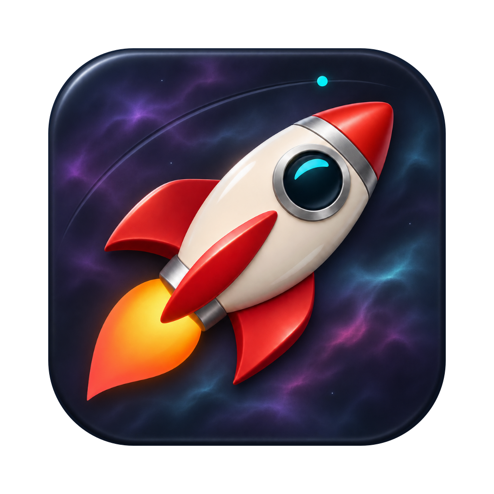
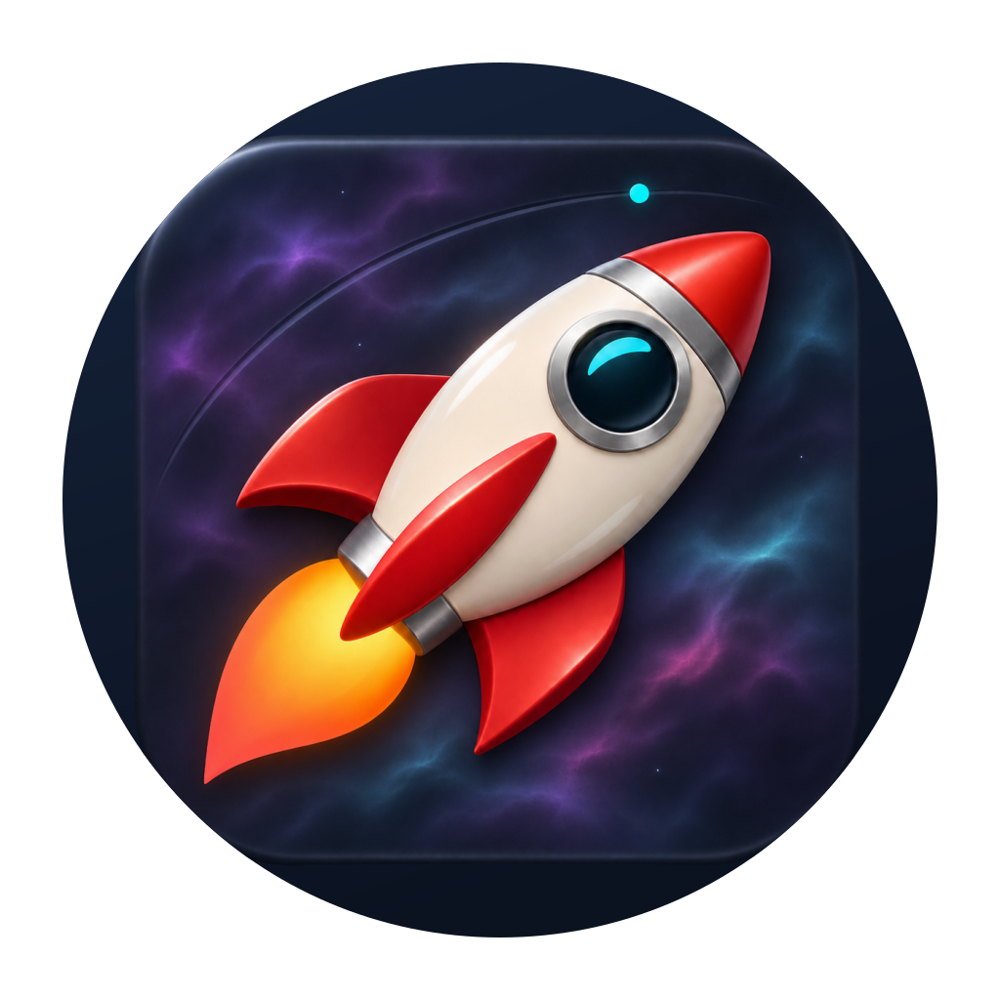

# Spaceport icons

## Canonical nebula rocket

The approved source is [`rocket-nebula.png`](../../design/spaceport-icon/rocket-nebula.png).
It is a sculpted ivory/red 🚀 rocket over violet and cyan nebula clouds, generated
with OpenAI imagegen from the earlier Twemoji concept. The exact prompts are
in [the design notes](../../design/spaceport-icon/README.md). Twemoji provenance
and its CC BY 4.0 license remain in [NOTICE](../../NOTICE) and
[LICENSE-twemoji](LICENSE-twemoji).

`sheprd-avatar.svg` and every platform SVG are generated, self-contained
envelopes embedding the exact approved PNG. The generator removes the master
image's measured transparent padding before applying platform margins and masks.
Do not edit these SVGs or derived raster exports by hand.

Existing asset filenames and the internal catalog key `Sheprd` remain so
packaging and embedded image references select the same files. Their artwork
and visible titles use Spaceport.

`sheprd-avatar.png` is the generated 1024×1024 avatar; it has not been uploaded.
This is the full-bleed square export. For a circular profile image, use the inset
Linux artwork below so the crop retains the rocket's nose and plume.
To regenerate only this square export:

```sh
rsvg-convert -w 1024 -h 1024 assets/icons/sheprd-avatar.svg \
  -o assets/icons/sheprd-avatar.png
```

## Platform artwork

| macOS / About | Linux |
| --- | --- |
|  |  |

| Output | Use |
| --- | --- |
| `sheprd-icon.{svg,png}` | Rounded desktop tile and About image |
| `sheprd-icon-badge.{svg,png}` | README tile with a notification badge |
| `sheprd-icon-square.{svg,png}` | Full-bleed square artwork |
| `sheprd-linux{,-worktree}.svg` | Circular Linux desktop icons |
| `Sheprd{,-worktree}.icns` | Multi-resolution macOS icons |
| `Sheprd{,-worktree}.car` | macOS 26+ Icon Composer catalogs |
| `Sheprd{,-worktree}.ico` | Windows executable / installer icons |
| `sheprd-worktree-1024.png`, `sheprd-square-worktree-1024.png` | Development About / square exports |
| `windows/wizard{-small,}-*.png` | Inno Setup page artwork |

Worktree builds add a berry rim (`#df4b62`) to distinguish development builds.
The approved image bytes and colors stay the same in both variants.

### Regeneration

Install `librsvg` (`brew install librsvg`) and Xcode 26 or newer on macOS,
then run `just icons`. Assets are checked in; ordinary builds need no renderer.
The individual steps, in order, are:

```sh
python3 scripts/generate-linux-icons.py
python3 scripts/generate-windows-icons.py
python3 scripts/generate-installer-images.py
swift scripts/generate-icons.swift
swift scripts/check-icons.swift
just check-artwork
```

The Python SVG generator derives the avatar and rounded, circular, square and
badge artwork from the approved PNG. The Swift generator renders each native
resolution and packages the macOS files.
Social sources and exports are generated by `python3 assets/branding/generate.py`.

### macOS sizing and catalogs

The flattened `.icns` follows Apple's macOS Sequoia production template:

| Canvas (px) | Tile (px) | Margin per side (px) |
| --- | --- | --- |
| 16 | 14 | 1 |
| 32 | 28 | 2 |
| 64 | 52 | 6 |
| 128 | 104 | 12 |
| 256 | 206 | 25 |
| 512 | 412 | 50 |
| 1024 | 824 | 100 |

Both variants have 1x and Retina 2x representations for logical sizes 16, 32,
128, 256, and 512. The embedded 1024px About image has the same 100px margin.
`check-icons.swift` checks every representation after extracting the `.icns`.

On macOS 26+, bundles ship the selected `.car` as `Contents/Resources/Assets.car`,
under icon name `Sheprd` for both variants. Icon Composer uses the canonical
full-bleed rocket PNG as a raster layer, with glass, specular effects,
translucency, and shadows disabled. macOS supplies the outer mask. The bundle's
display name is Spaceport and executable is `spaceport`; development builds and
signed previews retain their separate Spaceport bundle identities.

### Linux and Windows

The Linux circle is 896px across, with a 64px transparent margin on the 1024px
canvas. The artwork is inset within that circle to keep the nose and plume clear
of the crop. Packaging selects the normal or worktree SVG; the `.desktop` entry and
installed icon lookup name must agree. Desktops may cache or theme the icon.
`just icons-linux` needs only Python's standard library.

The Windows `.ico` contains PNG entries at 16, 20, 24, 32, 40, 48, 64, and
256px, each rendered from the rounded tile. `just icons-windows`
regenerates these and the installer images. It needs Python and `rsvg-convert`
(use WSL on Windows). The installer image generator also supports `resvg`.

## Interface and service marks

`plus.svg`, `close.svg`, `pencil.svg`, `trash.svg`, `chevron-up.svg`,
`chevron-down.svg`, `git-branch.svg`, `sessions.svg`, `file.svg`,
`zoom.svg`, the `window-*.svg` controls, `pull-request.svg`,
`user.svg`, `cpu.svg`, and `brain.svg` are original
interface artwork.
GPUI renders these as masks tinted by the current theme.

`error.svg` and `pass.svg` are unchanged Codicons from Microsoft's
vscode-codicons, under CC BY 4.0; `LICENSE-codicons` has the source revision,
license, and trademark notice.

## Sidebar agent marks

Each `agent-<label>.svg` is named after the external Herdr daemon's canonical
`agent_label` identifier, not an editable display label. The `agent_icons!`
table in `crates/sheprd-gpui/src/icons.rs` maps them; unknown, empty, and missing
identities use `agent-generic.svg`.

| Label | Source |
| --- | --- |
| `pi` | Lobe Icons `pi.svg` (Pi Agent, pi.dev) |
| `claude` | Lobe Icons `claude.svg` |
| `codex` | Lobe Icons `openai.svg` |
| `gemini` | Lobe Icons `gemini.svg` |
| `cursor` | Lobe Icons `cursor.svg` |
| `devin` | Lobe Icons `devin.svg` |
| `agy` | Lobe Icons `antigravity.svg` |
| `cline` | Lobe Icons `cline.svg` |
| `mastracode` | Lobe Icons `mastra.svg` |
| `opencode` | Lobe Icons `opencode.svg` |
| `copilot` | Lobe Icons `githubcopilot.svg` |
| `kimi` | Lobe Icons `kimi.svg` |
| `kiro` | Lobe Icons `kiro.svg` |
| `amp` | Lobe Icons `amp.svg` |
| `grok` | Lobe Icons `grok.svg` |
| `hermes` | Lobe Icons `hermesagent.svg` |
| `kilo` | Lobe Icons `kilocode.svg` |
| `qodercli` | Lobe Icons `qoder.svg` |
| `qwen` | Lobe Icons `qwen.svg` |
| `muse` | Lobe Icons `meta.svg` (Meta's mark; Muse Code has no redistributable mark) |
| `omp`, `droid`, `letta`, `maki` | Original lettermarks (O, D, L, M) |
| generic | Original terminal artwork |

Lobe Icons marks are MIT licensed; attribution and the full license are in
[NOTICE](../../NOTICE), shipped with releases. Their SVG wrappers were reduced
to 24px `currentColor` masks and titles removed; paths are unchanged. No
redistributable monochrome mark was found for oh-my-pi, Factory Droid, Letta,
or Maki, so those lettermarks and the generic mark are original artwork under
this project's Apache-2.0 license, with the same 2px round stroke.
