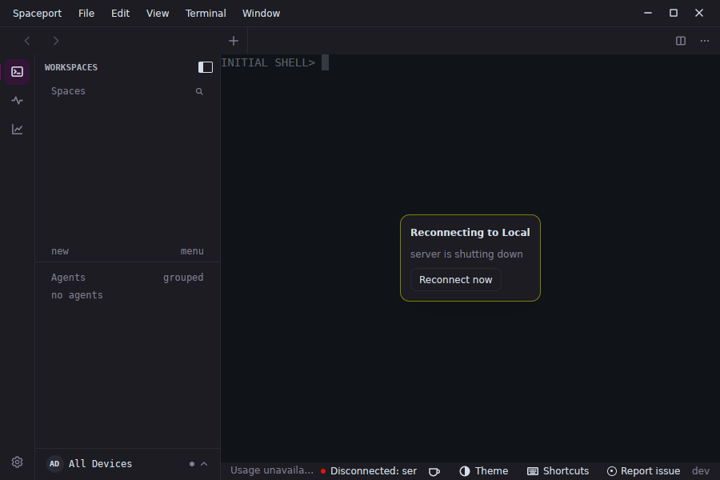
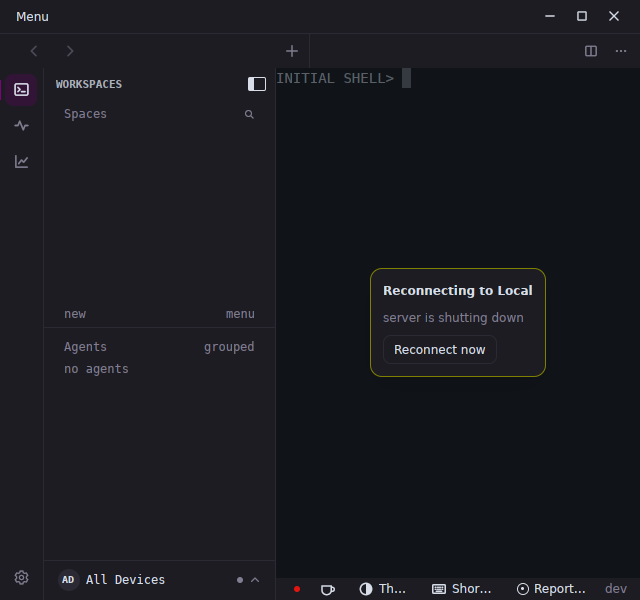

# Intentional Herdr shutdown replacement

This plan covers the review finding “Stop restarting a Herdr server the user stopped” (`bs4s`, under `9s44`).
Doctor Biz approved focused replacements for PR125.
Keep this replacement separate from unrelated connection and rendering work.

The source map compares main `b5cf4bf2b669888addb9fee84fb4cddccd0de064` with PR125 `ac69cfa006f7fd04ecdb80c3dad64f952343570f`.
The replacement starts from PR155's reviewed dependency stack at `39c62c96ffb3404c28caf30d620ce09feacceaf8`.
The [original receipt](https://github.com/2389-research/spaceport/blob/ac69cfa006f7fd04ecdb80c3dad64f952343570f/docs/evidence/review-herdr-shutdown.md) supplies historical evidence only.

## Required behavior

| Target or event | Required result |
| --- | --- |
| Local or ordinary named Session | Observed shutdown holds automatic restart until explicit reconnect. |
| SSH or WSL | Observed shutdown holds automatic bridge retry until explicit reconnect. |
| Explicit Socket | Keep ordinary attach-only retry. Never start a daemon. |
| Development Session | Keep its existing startup restriction. |
| Ordinary transport loss | Keep retry and backoff. |
| Parked group | Never start local Herdr. Wait for a serving primary before creating remote bridges. |
| Manual recovery | Complete handshake and snapshot recovery. Clear stopped advice after successful connection. |
| Retarget, detach, cancellation | Keep attempt ownership, generation fencing, and cancellation behavior. |

Retaining the last diagnostic during an explicit dial is allowed.
SSH and WSL retain upstream start-on-attach behavior.
The observed-shutdown guard cannot make remote attachment atomic with an external concurrent stop.

## Implementation sequence

1. Extend the public client ordering test in `crates/sheprd-client/src/tests/commands.rs`.
   Require Shutdown Message before Disconnected, with the same reason.
   Inspect actual CI failure before changing the client.
2. Forward the existing Shutdown Message in `crates/sheprd-client/src/session.rs` before returning its existing shutdown error.
   Keep event FIFO, bounded delivery, cancellation, and disconnect handling unchanged.
3. Add wire-level endpoint policy tests under `crates/sheprd-gpui/src/endpoint/lifecycle_tests/`.
   Cover stopped targets, ordinary loss, socket retry, retained advice, and successful explicit recovery.
   Add pure readiness cases in `crates/sheprd-gpui/src/endpoint/tests/retry_readiness.rs`.
   Exercise undrained, dirty, and lock-contended inbox states without timing guesses.
4. Retain shutdown in `crates/sheprd-gpui/src/state.rs` through disconnect and include it in display equality.
   Require a whole-window update before disconnect in `crates/sheprd-gpui/src/state/tests/shutdown.rs`.
   Clear it on accepted Connected.
5. Add Stopped advice in `crates/sheprd-gpui/src/endpoint/link.rs` and its phase in `endpoint/phase.rs`.
   Preserve version precedence and existing missing-install retry policy.
6. Add nonblocking retry readiness in `crates/sheprd-gpui/src/connection.rs`.
   Require the reader's drained flag and a clean inbox acquired with `try_lock`.
7. Thread the original Start permission through `daemon.rs`, `connection.rs`, and their existing callers.
   Primary endpoints use WhenMissing; parked connections use Never.
   Guard new parked bridges in `group_terminals.rs` until the primary serves.
   Test startup ownership in an isolated subprocess under `group_terminals/tests/parked_start_ownership.rs`.
8. Add focused parked-startup and recovery-card tests.
   Reuse `window/reconnecting.rs` and the existing reconnect action for the stopped card.
   Add only the required en-US endpoint and window messages.
   Check the existing CLI status consumer and reconnect command.

Use selected hunks from PR125's `150eed475` checkpoint.
Keep the existing reader implementation, stream transport, executable lookup, and dependency pins.
Exclude typed-error sweeps, pipe fixtures, caches, clipboard, notice timing, keyboard, and profiling changes.

## Safe test coordination

Use private fixture sockets and exact owned children.
Changing a fixture's target identity must not execute that target's transport.
Use raw endpoint polling to inspect Local, SSH, or WSL policy.
Repoint to an owned Socket before assertions or window event-loop progress.
Never run window polling against those identities during an unfixed baseline.

Do not copy the preserved test that waits for worker shutdown while holding the inbox lock.
Main's reader-driven waiter can block behind that same lock.
Use deterministic readiness states alongside real socket ordering.
Keep failed prerequisites distinct from the intended regression assertions.

## Qualification

Every checkpoint needs static checks, review, and actual CI evidence.
Run product tests and builds on disposable CI; local product execution remains held.
Require default and all-feature client and app results on the final source.
Verify real isolated Herdr shutdown and exact fixture cleanup with an explicitly selected binary.
Qualify the stopped card and explicit recovery at normal and narrow widths.
Keep native screenshots, real SSH/WSL recovery, and unsupported platform resources explicitly pending until exercised.
Doctor Biz's Mac foreground and audible-speech holds remain in force.
No native or release completion follows from source review or headless metadata.

### Linux CLI recovery checkpoint at `ab8cbf3df`

At this checkpoint, the Ubuntu 24.04 x64 all-features job ran
`shutdown::native_local_shutdown_and_reconnect` on a private Xvfb display.
The harness verified the Herdr v0.9.5 Linux x86_64 digest before starting either server.
Both servers shared the private socket and had separate restore directories.
The Local GUI kept its original window and a private startup trap.

The producer-before-card run used product revision `583b83f13`.
The fixed CLI checkpoint included product revision `43f722feb`.
After capturing both stopped widths, the fixed checkpoint started the replacement server
and invoked `spaceport window reconnect` through the private control socket.
Its artifact recorded the source SHA, binary digest, wire events, window status,
native images and completion receipt.

The [baseline run](https://github.com/2389-research/spaceport/actions/runs/44900991331/job/136836836772)
reaches the intended missing-label assertion after both captures.
The [receipt](herdr-shutdown-native/baseline.json) records source, binary, event, hold, window, and image identities.
Visual inspection confirms the old reconnect card is legible and unclipped at both widths.

The fixed CLI run captured the 640px stopped window with `active=false`.
Its completion receipt confirms GUI exit, replacement survival, and graceful server exit.
That run qualifies explicit CLI recovery. [Fixed CLI run](https://github.com/2389-research/spaceport/actions/runs/44902091234/job/136840193907).

### Native Start Herdr input

The earlier baseline covers the shutdown and stopped capture checks at 900px and 640px.
The current case keeps those checks and exercises the visible Start Herdr button
after the replacement handshake.
It focuses the same private X11 window and captures a fresh 640px image.
Tesseract supplies the pixel bounds of the two words on the button.
The harness requires one complete label and refuses ambiguous or invalid geometry.
[Tesseract TSV format](https://tesseract-ocr.github.io/tessdoc/Command-Line-Usage.html#tsv-output).

Before clicking, the harness checks X11 focus, the pointer position and the active
stopped Local window. It sends one left click through XTest. Inspect
`start-button.png`, `start-button.tsv`, `focused-stopped.json`, and
`start-button-click.txt` alongside the recovered image and completion receipt.
The recovered image must show the replacement shell prompt. [xdotool mouse and focus commands](https://github.com/jordansissel/xdotool/blob/main/xdotool.pod).

The native-click run and image inspection remain pending. Both server launches belong
to the harness. App-owned startup from absence, macOS and Windows presentation,
Windows typed shutdown, real SSH/WSL recovery, speech, and performance need separate evidence.
