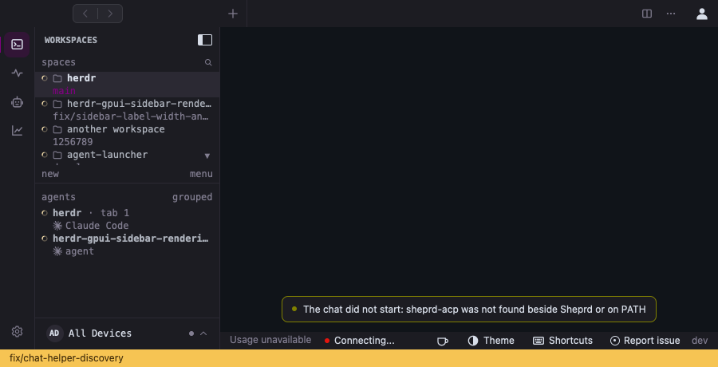
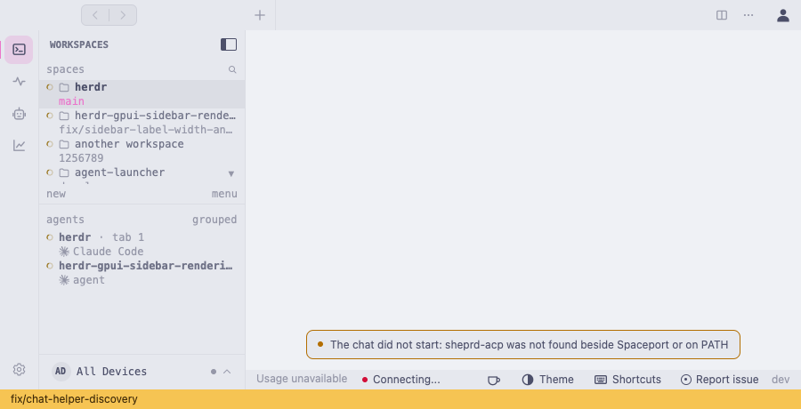
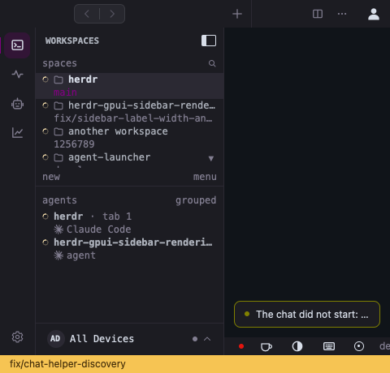
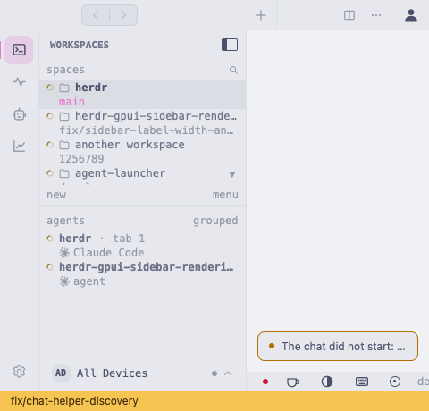

# T01: Chat startup failures name Spaceport

Kata `z9wm`, child of `rxkr`, addresses SP-022 from base `0eaed5cf5` in
`.worktrees/chat-helper-discovery`, branch `fix/chat-helper-discovery`.

The disconnected, helper-missing and helper-lookup-pending errors still named
Sheprd. They now use the existing shared product name. The preferred helper
filename comes from the existing bundled-name mapping, extracted into one
function used by both lookup and presentation. Fluent receives both identifiers
as data so pseudo-locales preserve them, including `.exe` on Windows.

The legacy `herdr-acp` lookup already prefers the shipped `sheprd-acp` before its
fallback; this was not a discovery bug. A new chat-level filesystem check passed
before the message changes, proving current packaged-name selection and bundled
legacy precedence over PATH. No lookup order, supported name, remote-host script,
tab/session ownership, permission or runtime lifecycle policy changed.

## Verification

Initial checks used Rust 1.99.0, empty `HERDR_BUILD_PR_NUMBER` and the existing
`.worktrees/sparkle-updates/target` cache as `CARGO_TARGET_DIR`.

- TDD `start_branding`: the two message checks first failed on Sheprd, while the
  shipped-helper lookup check passed before any production edit.
- `cargo test --locked -p sheprd-gpui --bin spaceport chat::tests::start`:
  14 passed, including English/pseudo-localized branding and existing start,
  refusal, command/environment and replaced-connection behavior.
- `cargo test --locked -p sheprd-gpui --bin spaceport bundled::tests`: six passed,
  covering preferred and legacy names, bundle/PATH precedence and external Core
  boundaries after extracting the unchanged mapping.
- `cargo test --locked -p sheprd-gpui --bin spaceport every_chat_start_variant_has_a_message`:
  passed all-variant English Display/localized-message parity.
- `cargo run --locked -p sheprd-acp -- --help`: built and ran the actual
  `sheprd-acp` executable successfully. The help path starts no agent or daemon.
- `cargo clippy --locked -p sheprd-gpui --all-targets -- -D warnings`,
  `just format-check check-file-size check-sorted check-i18n`, specification
  integrity and whitespace checks passed.

Logs remain under this worktree's `target/chat-helper-discovery/`. Existing
macOS compact-unwind linker and `block 0.1.6` future-compatibility warnings remain
unsuppressed. Filesystem probes test lookup only; their files are never executed.
Existing startup window tests use the headless protocol peer. Only the helper
help smoke check runs a real executable; none proves a real agent conversation.

## Native presentation qualification, 12 November 2026

The follow-up combines main `80f86276b` with this bounded message change.
It uses the task-owned `target/native-chat` compiler directory.
Only compiler cache directories were cloned from the earlier cache.
The frozen Sparkle fixture remains unchanged.

Current startup, bundled lookup and localization-parity checks passed again: 14, six and one tests.
The actual native presentation test passed:

```sh
RUSTUP_TOOLCHAIN=1.99.0 CARGO_TARGET_DIR="$PWD/target/native-chat" HERDR_BUILD_PR_NUMBER='' \
  cargo test --locked -p sheprd-gpui --features integration-test --test live_gui \
  chat_start::native_chat_start_errors -- --ignored --exact --nocapture --test-threads=1
```

The existing Sandbox launches one private native window without an agent or daemon.
The fixture calls the actual chat-error flash method and paints its real native scene.
It checks the diagnostic, viewport width and GPUI input focus across 36 cases.
Cases cover three errors, English and both pseudo-locales, light/dark themes, and 480/900px widths.
The optional `HERDR_TEST_CHAT_START_CAPTURE` directory stores native frame readbacks.
Capture forces a current paint because `render_to_image` reads the last painted scene.

Before captures use main's original message producers and catalog with the same fixture.
The three temporary source replacements were restored byte-for-byte afterward.
Before and after each passed all 36 presentation cases.
The qualified after executable has SHA-256 `e10135dbc8e3d2fed6bdda1da30edd5dc2cc031be6c7535c9f3b84602e2db347`.
It remains at `target/chat-helper-discovery/spaceport-after-painted`.
Logs remain at `native-before-painted.log` and `native-after-painted.log` in that artifact directory.

These pairs show the same helper-missing error through the native renderer.
Narrow flashes retain the existing single-line ellipsis policy in both versions.

| Appearance | Before | After |
| --- | --- | --- |
| Dark, 900px |  |  |
| Light, 900px |  |  |
| Dark, 480px |  |  |
| Light, 480px |  |  |

The broader `native_sidebar` test fails with both message versions at host step 3.
It observes selected endpoint 1 after expecting Local endpoint 0.
Kata `ec11` tracks that independent failure under native macOS acceptance `6q5m`.
No host assertion was weakened or retried.
This presentation result does not establish OS IME, real-agent startup or full chat parity.
Platform CI remains pending for the updated branch. Windows remains paused under D66.
Broad T01/T06/A42, native acceptance and `rxkr` remain open.
