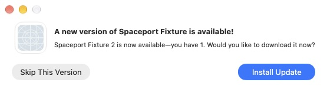
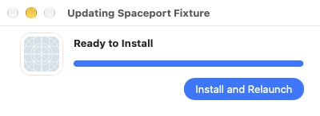

# Sparkle local test baseline 20261111.1

Status: Developer ID signed local test app; not notarized or qualified for
public distribution. No release tag, public update feed or notary submission
was created for this version.

## Source and hosted build

- PR #1 merged as `4a2604b4efc9cb5c1abca91b6d7a1392e55ab28b`.
- Full PR CI passed at `93416b82d`; the merge preserves its reviewed source.
- [Manual workflow 43050080707](https://github.com/harperreed/spaceport/actions/runs/43050080707)
  built arm64 release-profile bytes with Sparkle enabled and passed CLI smoke.
- Unsigned artifact ID `13870845734`, SHA-256
  `6e981c918e5bfeda2f83d134281bcb77cfce753b4d2a7542d2d37591d0f9c4bb`.
  The downloaded outer archive, app ZIP and release notes matched their checksums.
- Main CI's macOS/Windows jobs passed. Linux dependency installation failed
  resolving Ubuntu mirrors during the [reported DNS outage](https://status.canonical.com/rss).
  The stalled remainder was cancelled to release the queued full retry
  [43053306222](https://github.com/harperreed/spaceport/actions/runs/43053306222).
  The preview stopped at its CI gate before the signing job or any notary submission.
  Version `20261111.1` remains reserved; do not rerun that preview workflow.

## Local test copy

The same unsigned app was copied for local testing. Its pinned framework and
license bytes, preview identity and signed-feed policy passed validation before
credentials. The packager deliberately strips app signatures; macOS killed an
attempt to launch that unsigned copy. It is not a usable test app until signed.

Known nested framework code, the chat adapter, executable and app were then
signed inside out using the existing approved Developer ID identity. This local
test operation did not submit for notarization or publish any artifact/feed. The hosted
distributable remains subject to successful exact-main CI and native QA.

- Identifier: `ai.2389.spaceport`; Team: `HD9NM9NSMK`.
- Version/profile/architecture: `20261111.1`, `release`, `arm64`.
- Sparkle `2.10.1`; signed-feed requirement, exact-zero failure expiry and
  archive validation before extraction are present. Automatic install defaults off.
- `codesign --verify --deep --strict`: passed for the local app and nested code.
- `preview-identity.py 20261111.1 release`: passed.
- `smoke-cli.py` on the bundled executable, with DYLD overrides removed: passed.
- Local app: `target/hosted-preview/20261111.1/local-test/Spaceport.app`.
- ZIP: `target/hosted-preview/20261111.1/Spaceport-20261111.1-local-test.zip`.
- ZIP SHA-256: `15608cec0d49e5d2d6e99118b6768e39675bcb3b9497aac39b832f1f32e0ef40`.

This is the manual baseline. Its production preview feed has not been published;
the later qualified release supplies the update to discover.

## Native fixture findings

The real signed ZIP case `valid-zip-m5s1zpty` downloaded its archive, installed
version 2, exited its old process, and triggered LaunchServices for the new app.
The new host exited because LaunchServices replaced HOME despite signed
LSEnvironment. It correctly failed the full case; evidence and scoped cleanup
were retained. No personal Spaceport preferences or app were used.





A bounded same-PID exec now restores the validated private fixture environment
before all original isolation checks. Five real signed startup regressions and
35 driver tests passed; strict example Clippy and quick static checks passed.
Independent source review found no Important issue. The corrected host SHA-256
is `c9c19fc29002bffe9f4c6d6983af28e3f71ce923968a3b427fbb91113347b818`.
The corrected ZIP case `valid-zip-6qngxk39` could not receive native input after
the desktop relocked, so it timed out and cleaned up. ZIP/DMG install/relaunch,
archive/payload refusal cases, installed-app UI, and the actual feed round trip
remain unqualified. T12/A43 stay open.

The startup suite runs explicitly against the compiled fixture and pinned SDK:

```sh
python3 scripts/release/tests/test_sparkle_fixture_startup.py \
  --host target/debug/examples/sparkle_fixture --sdk target/sparkle-sdk
```

It exits after the isolation checks; it does not replace an update/relaunch test.

Build-tool output also records the existing `block 0.1.6` future-compatibility
notice and yanked `spin 0.10.0`/`core2 0.4.0` entries in pinned git-cliff's lockfile.
Those warnings did not fail compilation; no dependency versions were changed.
