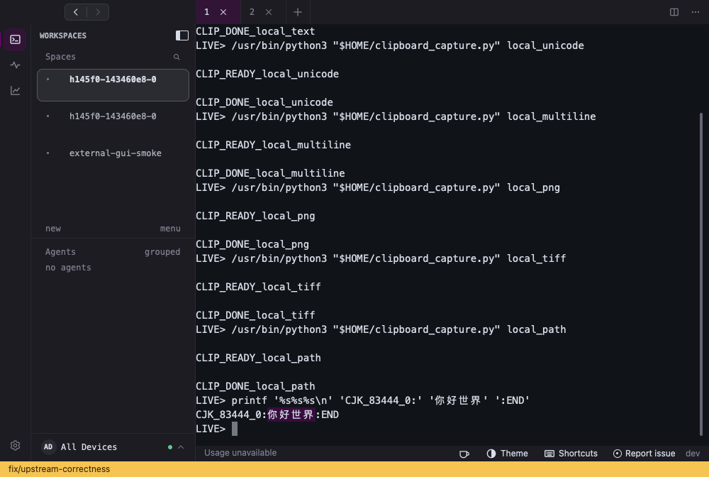

# Upstream correctness backports

Doctor Biz approved the three high-priority backports on 16 November 2026.
He then approved a review squad and merging the reviewed changes to main.
The implementation starts from Spaceport `5278d911a`.

## Script deadlines

Adapt the runner portion of Sheprd `6b777833d`.
Keep cancellation and idle deadlines active until all pipe workers finish.
Keep the parent unreaped while pipes remain active.
This reserves its process-group identity until cleanup.
The existing Windows process policy remains in place.

The regression returned `Ok(0)` after two seconds before the fix.
It now returns `ScriptTimeout` within its bound.
The script test group passes all 18 tests.

## Terminal text

Port Sheprd `f6b519e2a` and its followup `47474d8ae`.
Recognize continuation cells without relying on the wire's `skip` flag.
Preserve text and real spaces after narrow emoji sequences.
Retain Spaceport's shared `CellMetrics` geometry.
The added cases produced 13 failures before the fix.
All 137 terminal tests now pass.

## Headless chat exits

Adapt Sheprd `8ec1ca071` without its recovery machinery.
Return failure when the agent or session thread ends unexpectedly.
Keep deliberate shutdown and successful agent exits successful.
The isolated helper test originally reported success for an agent's exit code 7.
Both helper exit cases and the shared sandbox checks now pass.

## Verification

- `cargo test --locked -p sheprd-client -p sheprd-acp`: passed.
- `cargo test --locked -p sheprd-gpui --features integration-test --bin spaceport terminal::`: passed.
- `just format-check check-file-size check-sorted check-i18n`: passed.
- `cargo clippy --locked -p sheprd-client -p sheprd-acp -p sheprd-gpui --all-targets --features integration-test -- -D warnings`: passed.
  Cargo still reports the existing `block 0.1.6` future-compatibility warning.
- The isolated `native_gui_live` test passed on macOS with explicit Herdr 0.9.5.
  It verified native CJK selection, clipboard text, and paste byte readback.
- Windows, Linux, all-feature checks, and full workspace CI remain deferred to CI.

One independent review found the early parent-reaping race.
The runner now defers reaping until its pipe workers finish.
PID reuse itself was not stress-tested.

## Review squad

Three independent reviewers checked the final source diff and new fixtures.
The process reviewer checked ownership, cancellation, reaping, and helper exits.
The terminal reviewer checked Unicode, bounds, accessibility callers, and geometry.
The compatibility reviewer checked isolation, platform gates, scope, and evidence.
They found no blocking issues.
Their focused test runs also passed.
Direct cancellation-after-parent-exit and session-thread-panic fixtures remain coverage gaps.

## Native window evidence

The images document native CJK drag selection.
Regression tests cover the link and double-click failures.
Both isolated native smoke runs passed.
Temporary screenshot instrumentation was removed after capture.

| Before terminal backport | After terminal backport |
| --- | --- |
|  |  |

## Sources

- [Script runner](https://github.com/sheprd-labs/sheprd/commit/6b777833d)
- [Wide-character links](https://github.com/sheprd-labs/sheprd/commit/f6b519e2a)
- [Narrow emoji followup](https://github.com/sheprd-labs/sheprd/commit/47474d8ae)
- [Headless exits](https://github.com/sheprd-labs/sheprd/commit/8ec1ca071)
